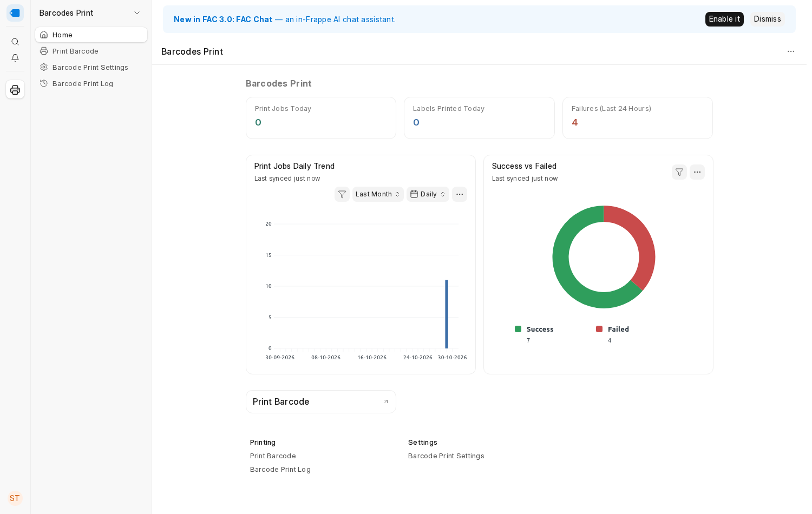
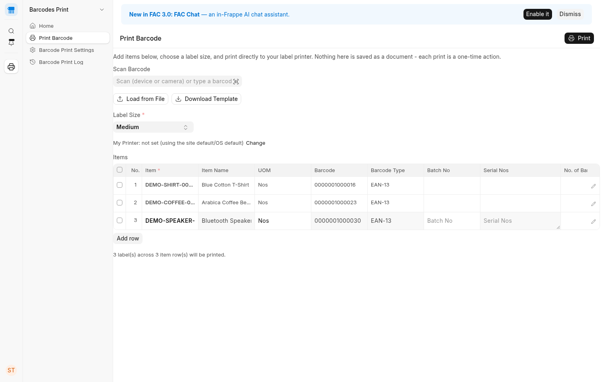
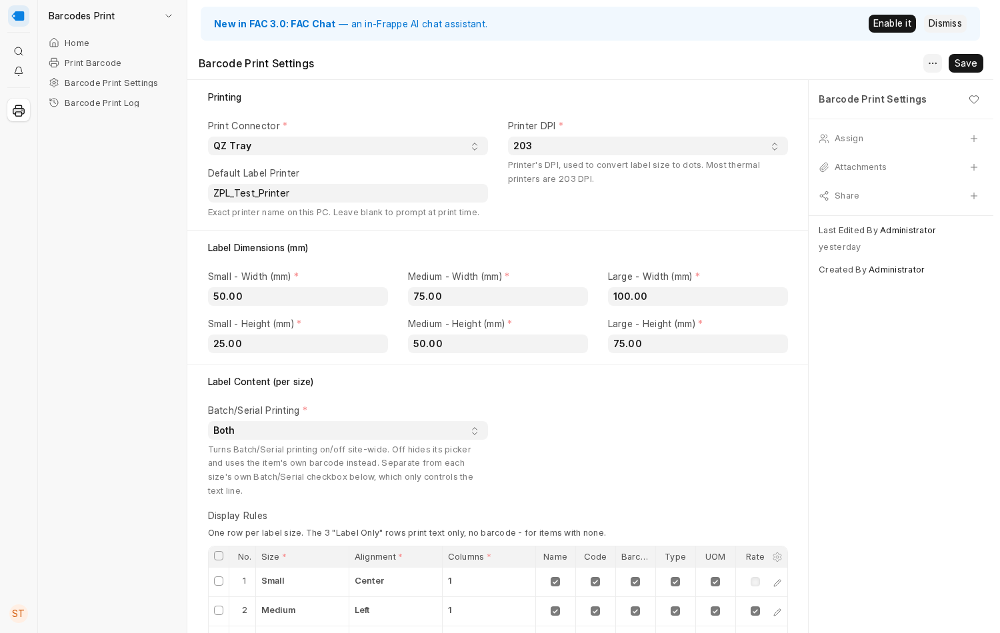
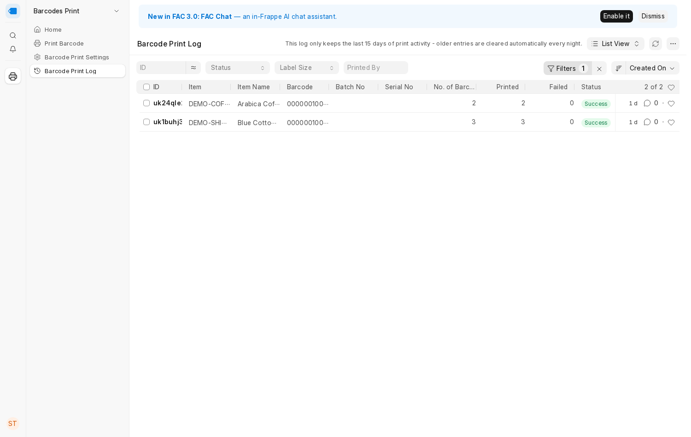

# Barcodes Print

[](https://github.com/Rahul-ai1/ERPNext-Barcodes-Print/actions/workflows/ci.yml)
[](license.txt)

Direct-to-printer **barcode label printing** for ERPNext, via QZ Tray or Zebra Browser Print.

You add items (or open it straight from a submitted Purchase Order/Purchase Receipt), pick a label size, and click Print — the label goes straight to a local thermal printer as raw ZPL. No print preview, no browser print dialog, no PDF step.

## User Manual

[](https://github.com/Rahul-ai1/ERPNext-Barcodes-Print/raw/main/docs/Barcodes_Print_User_Manual.pdf)

Step-by-step guide to every screen and setting — [download the User Manual (PDF)](https://github.com/Rahul-ai1/ERPNext-Barcodes-Print/raw/main/docs/Barcodes_Print_User_Manual.pdf).

## Why this matters

Standard ERPNext barcode printing means generating a print format, opening a browser print-preview screen, and sending it through the OS print dialog — slow for a warehouse doing this dozens of times a day, and it renders barcodes as an image rather than native printer commands, which prints noticeably softer/slower on thermal printers than the printer's own barcode engine. There's also no size-aware protection against printing an unscannable code (a QR code squeezed onto a tiny label with too many other fields on it will fail to scan in practice, not just in theory), and no record of who printed what, when, or how many — reprints for damaged labels happen with no trace and no limit.

This app replaces all of that with a one-time-use print action: raw ZPL sent directly to the printer via a local desktop agent (QZ Tray, or Zebra Browser Print on Windows/macOS), label content and barcode bar width that scale to the label size you actually pick, a hard block on print combinations that would be too small to scan reliably, and an audit log of every print attempt — including failures and why.

## What it does

Barcodes Print ships its own sidebar workspace and app icon, so it shows up on the Desk home screen and left sidebar like any other module:



**Print Barcode page.** The only way to print — add item rows (auto-fetching Item Name/UOM/Barcode/Barcode Type as you go), pick Small/Medium/Large, and print. Nothing here is ever saved as a document; a live running total keeps you honest about how many labels are about to go to the printer before you commit.

If an Item has more than one barcode registered, you're asked which one to use rather than the system silently guessing the first one in the list — unless exactly one is marked **Default** in the Item's own Barcodes table, in which case that one is picked automatically.

**My Printer.** Each user can save their own default printer from a live dropdown of whatever QZ Tray/Zebra Browser Print currently sees connected — it's remembered per user (not per browser/site), and wins over the site-wide Default Label Printer whenever it's set.

**Scan Barcode.** A dedicated scan box fills or updates a row the moment you scan — a barcode, Serial No, or Batch No (or just type an Item Code), the same way ERPNext's own scan fields work everywhere else. Works with an external USB/Bluetooth scanner (no Enter keystroke required — it commits automatically a moment after scanning/typing stops) and with a device's own camera via the built-in scan icon, for anyone without external scanner hardware. Scanning the same plain item again increments its row instead of adding a duplicate; a batch-tracked item matches by item **and** batch (a different batch gets its own row); a serial-tracked item's repeat scan adds the new serial to that row's list.

**Load from Excel/CSV.** Bulk-fill the grid from a spreadsheet instead of adding rows one at a time — **Download Template** exports the grid's current rows as a starting point, **Load from File** reads an `.xlsx`/`.xls`/`.csv` back in, validating each row independently (bad rows are skipped and listed, never a whole-file failure) with a 1,000-row cap.



**Stock Qty.** A read-only, informational column shows each row's on-hand quantity (scoped to the picked Batch No, where relevant) — never printed on the label, just a courtesy figure before deciding how many to print. Blank for service/non-stock items.

**"Label Only" sizes.** For an Item that genuinely has no barcode, three extra size choices — Small/Medium/Large **Label Only** — print a clean text-only label (Item Name, Code, UOM, Rate) with no barcode field at all. This is a deliberate, explicit choice: the regular Small/Medium/Large sizes are completely unaffected and still require a real barcode.

**Batch No / Serial No.** For batch- or serial-tracked items, pick (or scan) the exact Batch No/Serial No a label run is for — the label's own barcode then encodes that Batch/Serial directly, so scanning it anywhere in ERPNext resolves the Item (and Batch, for a Serial No) automatically. One label prints per Serial No selected. Whether this is offered at all is a single site-wide switch (Both/Batch Only/Serial Only/Neither in Settings); whether the resolved Batch/Serial text actually appears on the printed label is a separate, per-size choice — the two are independent on purpose, so a company can encode Batch/Serial into every label's barcode while only showing the text on the larger sizes, for example.

**Purchase Order / Purchase Receipt / Purchase Invoice integration (optional, off by default).** Turn it on in Settings and pick exactly one of the three document types — a **Print Barcode** button then appears on submitted documents of that type, pre-filling the page with that document's items, including each line's own Batch No/Serial No, Company, and Tax Template straight from the document (both the legacy `use_serial_batch_fields` mode and the default Serial and Batch Bundle mode are handled). A Return (credit note) Purchase Invoice never gets the button. Each line's starting quantity defaults to whatever's still allowed (line quantity + a configurable number of extras, minus what's already been printed for that line), and a per-line **Barcodes Printed** counter tracks the running total. The limit is re-checked against the database on every print — a user can't bypass it by editing the request.

**Rate, with or without tax.** The Rate line is pulled from a Price List (never `Item.standard_rate`) and left off the label entirely if no price is found for that Item/Price List — never a misleading "0.00" or "N/A". Optionally pick a Company and Tax Template on a row (auto-filled from your own default Company, or straight from the Purchase Order/Receipt line when printing from one) and the Rate is marked up by that template's own tax % before printing, with a short **"Incl. of taxes"** note next to it; leave Tax Template blank and it prints the plain Price List rate marked **"Excl. of taxes"**. The tax percentage and the Company/template name are never printed — only the final Rate and that one-line note. A site-wide **Print Price As** setting (Rate/MRP) optionally prefixes that line with **"MRP: "** instead — off by default, so existing installs see no change.

**Barcode Print Settings.** One screen controls everything:
- **Print Connector** — QZ Tray or Zebra Browser Print, one at a time, plus the default printer name and printer DPI.
- **Label Dimensions (mm)** — width/height for Small, Medium, and Large.
- **Batch/Serial Printing** — site-wide: Both / Batch Only / Serial Only / Neither.
- **Display Rules** — a table with one row per label size (Small/Medium/Large, plus their three **Label Only** variants): independent show/hide checkboxes, a Left/Center/Right alignment, and a **Columns** choice (1 or 2), per size. A field can be off for Small but on for Medium/Large. **2 columns** splits that size's enabled text fields side-by-side below the barcode (the barcode itself always stays full-width) — blocked at save time if that size's own Label Dimensions is under 40mm wide, since two legible columns need the room.
- **Default Price List** — used to auto-fetch each row's Rate when Display Rules show it; overridable per row.
- **Purchase Document Printing** — the enable flag, which of the three document types, and the extra-barcodes allowance described above.



**Barcode Print Log.** A read-mostly audit trail written automatically after every print attempt — item, barcode, quantity requested vs. actually printed vs. failed, a status of Success/Failed with the failure reason on record, and which Purchase Order/Receipt line (if any) it came from. QZ Tray and Zebra Browser Print each send one combined job per print action, so success/failure is tracked per print action, not per individual label within it.



**Dashboard.** The workspace home screen also shows live Number Cards (Print Jobs Today, Labels Printed Today, Failures Last 24h) and two charts (Success vs. Failed, Print Jobs Daily Trend) computed straight from the Print Log — a running health check with no setup required.


## Doctypes

| Doctype | Type | Purpose |
|---|---|---|
| Barcode Print Settings | Single | Central configuration — the only doctype with one record per site. |
| Barcode Label Display Rule | Child table | One row per label size (Small/Medium/Large, plus 3 "Label Only" variants): display toggles + alignment. |
| Print Label Item | Child table | Row schema for the Print Barcode page's item grid — not a persisted business record. Includes Batch No, Serial Nos, Company, and Tax Template. |
| Barcode Print Log | Standalone | Audit trail of every print attempt, success or failure. |

## Pages

| Page | Purpose |
|---|---|
| Print Barcode | The only printing UI — one-time-use, nothing saved as a document. |

## Barcode types supported

EAN-13, EAN-8, UPC-A, UPC-E, Code 39, Code 128, ITF / ITF-14 / GTIN-14, Codabar, QR Code, and Data Matrix each get their own native ZPL barcode command (not an image render). ISBN/ISSN/JAN/PZN and anything else without a dedicated ZPL symbology fall back to Code 128, which safely encodes any text/alphanumeric value.

If an Item's barcode has no type recorded, the type is auto-detected from the value itself, in this priority order: **EAN-13 → EAN-8 → UPC → Code 39 → Code 128**. QR Code and Data Matrix are only ever used when explicitly set on the Item — never auto-detected — and printing one is blocked outright (not just discouraged) if the chosen label size and display toggles would render it under 10mm, the accepted floor for reliable scanning.

## QZ Tray setup (end users, one time)

Each PC that will actually print needs QZ Tray running locally:

1. Download QZ Tray from [qz.io/download](https://qz.io/download/) and install it.
2. Launch it — confirm it's running in the system tray (Windows) or menu bar (macOS/Linux).
3. Connect the label printer to that PC and note its exact name as it appears in the OS's printer list.
4. Set the printer's label roll size in its OS driver preferences.
5. In **Barcode Print Settings**, set the exact printer name under **Default Label Printer** (optional — if left blank, QZ Tray falls back to that PC's own default printer).
6. The first time a print happens from a given browser/site, QZ Tray shows a one-time "Action Required" popup — check **Remember this decision** and click **Allow**.

From then on, clicking Print on the Print Barcode page sends straight to that printer — no further prompts, no browser dialog.

## Compatibility

Built and tested against **Frappe v16.26 / ERPNext v16.26**, with CI running the full test suite on both **Frappe v15** and **v16** on every push. Installs cleanly on **Frappe v15** too - the Desk sidebar entry and app icon are skipped there (Workspace Sidebar/Desktop Icon are Frappe v16-only doctypes), but every doctype, page, and printing feature works the same on both versions.

## Install

```bash
bench get-app https://github.com/Rahul-ai1/ERPNext-Barcodes-Print.git
bench --site <your-site> install-app barcodes_print
bench --site <your-site> migrate
bench restart
```

## License

MIT
